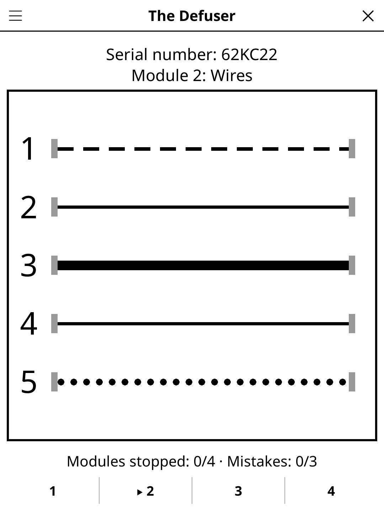

# defuser.koplugin

**The Defuser** (*Le désamorceur*) is a cooperative game for
[KOReader](https://github.com/koreader/koreader), played by two people with a
reader each. An alarm machine is about to ring: the operator has the machine,
the expert has its manual. Neither can stop it alone.

## How to play

1. One player opens **New game → Start a game** and reads the five-digit
   code aloud; the other opens **New game → Join a game** and types it. One
   is the operator (the machine), the other the expert (the manual).
2. The operator describes the machine: its serial number and each module
   (tabs at the bottom). The expert finds the right page of the manual and
   says what to do.
   - **Wires**: the rules for that number of wires, read in order; the first
     one that applies says which wire to cut (counted from the top).
   - **Symbols**: exactly one column of the manual holds all four symbols;
     press them in that column's order.
   - **Dial**: the shape on the display and the lamp (off or lit) give the
     dial position in the manual's table; turn the dial, then **Set**.
3. Every wrong move is a mistake; at the third, the alarm rings. Stop every
   module to win.

## Features

- **No connection needed** — both readers build the same machine and the
  same manual from the code.
- **A new manual every game** — the wire rules, the symbol columns and the
  dial table are drawn from the code, so nothing can be learned by heart.
- **Three levels**, set by the player who starts: 3, 4 or 5 modules.
- **Honest machine** — the operator's reader checks every cut, press and
  setting, and times the whole defusing.
- **Auto-save**; **Show the game code** reads it again.
- French, Spanish and German translations.

## Why e-ink friendly?

No countdown ticking on screen: each action repaints one module.

## License

GPL-3.0
